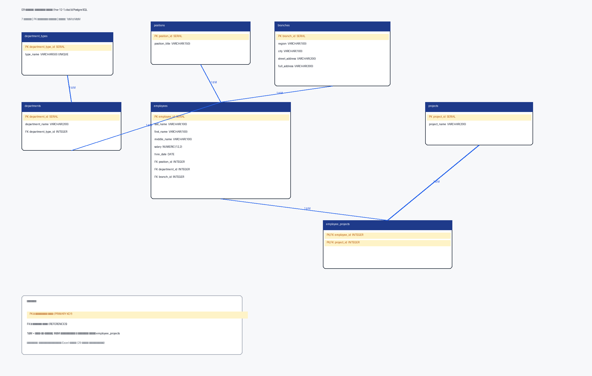

# Домашнее задание к занятию «Базы данных» — Дорофеев Максим

### Инструкция по выполнению домашнего задания

1. Сделайте fork [репозитория c шаблоном решения](https://github.com/netology-code/sys-pattern-homework) к себе в Github и переименуйте его по названию или номеру занятия.
2. Выполните клонирование этого репозитория к себе на ПК с помощью команды `git clone`.
3. Выполните домашнее задание и заполните у себя локально этот файл README.md.
4. После завершения работы сделайте коммит и отправьте его на Github (`git push origin`).
5. Для проверки в личном кабинете прикрепите ссылку на решение в виде md-файла в вашем Github.

---

### Легенда

Заказчик передал файл в формате Excel (`hw-12-1.xlsx`), в котором сформирован отчёт.

На основе этого отчёта нужно выполнить следующие задания.

Исходный отчёт — одна денормализованная таблица со столбцами:

- ФИО сотрудника
- Оклад
- Должность
- Тип подразделения
- Структурное подразделение
- Дата найма
- Адрес филиала
- Проект, на который назначен (в одной ячейке может быть несколько проектов)

---

### Задание 1

Опишите не менее семи таблиц, из которых состоит база данных:

- какие данные хранятся в этих таблицах;
- какой тип данных у столбцов в этих таблицах, если данные хранятся в PostgreSQL.

Начертите схему полученной модели данных.

#### ОТВЕТ:

На основе отчёта выделено **7 таблиц**. Кратко: справочники (типы подразделений, подразделения, должности, филиалы, проекты), центральная таблица сотрудников и связующая таблица назначений на проекты (многие-ко-многим).

**1. типы_подразделений** (

- идентификатор типа подразделения, первичный ключ, SERIAL,
- название типа подразделения, VARCHAR(50)
)

Хранит: «Отдел», «Группа», «Департамент».

**2. структурные_подразделения** (

- идентификатор структурного подразделения, первичный ключ, SERIAL,
- название структурного подразделения, VARCHAR(200),
- идентификатор типа подразделения, внешний ключ, INTEGER
)

Хранит: конкретные подразделения («Группа CRM 2», «Центр разработки Medio» и т.д.).

**3. должности** (

- идентификатор должности, первичный ключ, SERIAL,
- название должности, VARCHAR(150)
)

Хранит: справочник должностей («ведущий разработчик», «старший инженер» и т.д.).

**4. филиалы** (

- идентификатор филиала, первичный ключ, SERIAL,
- регион / край / область, VARCHAR(100),
- город, VARCHAR(100),
- улица и дом, VARCHAR(200),
- полный адрес, VARCHAR(300)
)

Хранит: адреса офисов (в отчёте 3 уникальных филиала).

**5. сотрудники** (

- идентификатор сотрудника, первичный ключ, SERIAL,
- фамилия, VARCHAR(100),
- имя, VARCHAR(100),
- отчество, VARCHAR(100),
- оклад, NUMERIC(12,2),
- дата найма, DATE,
- идентификатор должности, внешний ключ, INTEGER,
- идентификатор структурного подразделения, внешний ключ, INTEGER,
- идентификатор филиала, внешний ключ, INTEGER
)

Хранит: данные о сотрудниках и ссылки на должность, подразделение и филиал.

**6. проекты** (

- идентификатор проекта, первичный ключ, SERIAL,
- название проекта, VARCHAR(200)
)

Хранит: названия проектов из отчёта.

**7. назначения_на_проекты** (

- идентификатор сотрудника, первичный ключ / внешний ключ, INTEGER,
- идентификатор проекта, первичный ключ / внешний ключ, INTEGER
)

Хранит: связь сотрудник ↔ проект (многие-ко-многим). Составной первичный ключ из двух внешних ключей.

---

#### Типы связей

| Связь | Тип |
|---|---|
| типы_подразделений → структурные_подразделения | один-ко-многим (1:M) |
| структурные_подразделения → сотрудники | один-ко-многим (1:M) |
| должности → сотрудники | один-ко-многим (1:M) |
| филиалы → сотрудники | один-ко-многим (1:M) |
| сотрудники ↔ проекты через назначения_на_проекты | многие-ко-многим (M:N) |

---

#### Схема модели данных

На схеме отображены:

- все 7 таблиц с названиями;
- столбцы с типами данных PostgreSQL;
- первичные ключи (PK, выделены);
- внешние ключи (FK);
- линии связей между таблицами.

Файл схемы для редактора diagrams.net: [`er-schema.drawio`](er-schema.drawio)  
DDL PostgreSQL (для справки): [`schema.sql`](schema.sql)

---

## Дополнительные задания (со звёздочкой*)

### Задание 2*

Перечислите, какие, на ваш взгляд, в этой денормализованной таблице встречаются функциональные зависимости и какие правила вывода нужно применить, чтобы нормализовать данные.

#### ОТВЕТ:

**Функциональные зависимости в исходном Excel:**

1. ФИО сотрудника → оклад, дата найма, должность, структурное подразделение, адрес филиала  
   (один сотрудник определяет свои атрибуты).
2. Структурное подразделение → тип подразделения  
   (у подразделения один тип: Отдел / Группа / Департамент).
3. Адрес филиала → регион, город, улица  
   (полный адрес определяет свои части).
4. Должность → (только сама себе как справочник; название должности атомарно).

**Нарушения и правила нормализации:**

1. **1НФ (атомарность):** ячейка «Проект…» содержит несколько проектов через запятую → разбить на отдельные строки связи сотрудник–проект (таблица `назначения_на_проекты`).
2. **2НФ / устранение частичных зависимостей через суррогатные ключи:** вынести повторяющиеся справочники в отдельные таблицы (`должности`, `филиалы`, `проекты`, `типы_подразделений`, `структурные_подразделения`).
3. **3НФ (транзитивные зависимости):** тип подразделения зависит от структурного подразделения, а не напрямую от сотрудника → тип хранить в `структурные_подразделения`, а не дублировать у каждого сотрудника.

Итог применения правил — модель из семи таблиц выше.
